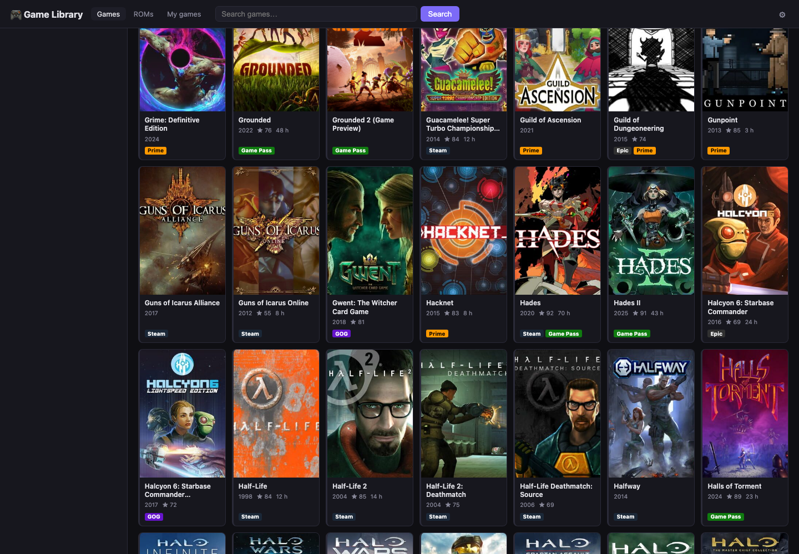
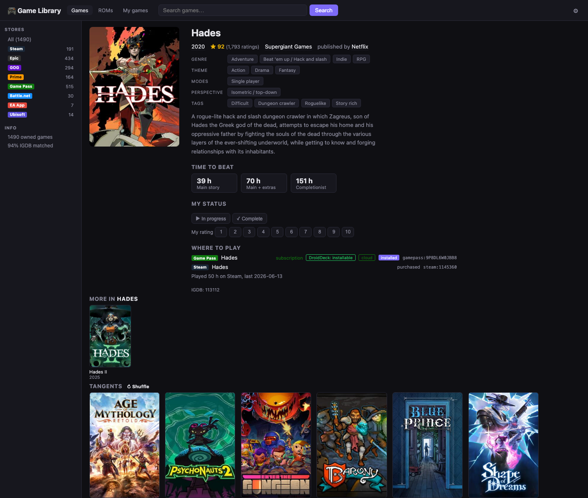

# game-catalog

One searchable library of every game I own or can play, no matter which launcher it lives in. It pulls in Steam, Epic, GOG and Amazon (through Heroic), Lutris, Xbox Game Pass and my ES-DE emulation library, puts it all in one SQLite database, and matches everything to [IGDB](https://www.igdb.com) for genres, themes, ratings, art and time-to-beat. From there you get two ways to use it:

- **A web portal** you can open from any device on your network. Filter by store, genre, theme, mode, rating or length, open a game or ROM page to see "if you liked this" picks, and keep track of what you're playing and how you'd rate it.
- **An MCP server**, so Claude (or another MCP client) can answer "what should I play tonight?" from what you actually own.





I started this because I got an Odin 2 Portal and a Mac Mini running Bazzite and between Steam, a pile of free Epic and Prime claims, Game Pass and a big emulation library, the choices of what to play with my limited time were overwhelming. My setup is a 2018 Mac mini running [Bazzite](https://bazzite.gg), plus an AYN Odin 2 Portal handheld (Android) that can play some Game Pass titles through DroidDeck. The Odin parts are optional. Everything else should work on any Linux box where these launchers keep their default paths.

_Important Note: This is a personal project shared as-is. I'm not taking issues or pull requests and I can't help with setup, but you're more than welcome to fork it and make it your own. It was written with [Claude Code](https://claude.com/claude-code), and the comments explain the why along with the what, so it should still be useful if you only want to borrow a few ideas._

## What it reads

| Source | How | What you need |
|---|---|---|
| Steam | Steam Web API (`importers/steam.py`) | An API key and your SteamID64 in `steam.env` |
| Epic, GOG, Amazon Prime Gaming | Heroic's library caches (`importers/heroic.py`); Epic is refreshed headlessly with Heroic's bundled `legendary` | Heroic (Flatpak), signed in to each store |
| Lutris | `~/.local/share/lutris/pga.db` (`importers/lutris.py`) | Lutris, if you use it |
| Xbox Game Pass | Microsoft's public catalog endpoints, no sign-in (`importers/gamepass.py`); installed titles from Xodus Nexus (`importers/xodus.py`) | Nothing for the catalog; Xodus Nexus for installed titles |
| ES-DE ROMs | `~/ES-DE/gamelists/*/gamelist.xml` and downloaded media (`importers/esde.py`, `match_roms.py`) | ES-DE |
| IGDB | Twitch-authenticated IGDB API (`merge.py`, `enrich_details.py`, `match_roms.py`) | A Twitch application's client ID and secret in `igdb.env` |

If you don't have one of these, it just gets skipped. [`docs/data-sources.md`](docs/data-sources.md) goes into where each launcher keeps its data and the gotchas I ran into along the way.

## Setup

Everything runs as your user, no root and no containers, which keeps it friendly for Bazzite and other immutable distros.

```bash
# 1. The code, in ~/game-catalog (the systemd units expect this path)
git clone https://github.com/daboyter/game-catalog.git ~/game-catalog

# 2. A Python venv with the two packages (Flask and the MCP SDK)
python3 -m venv ~/game-catalog-venv
~/game-catalog-venv/bin/pip install -r ~/game-catalog/requirements.txt

# 3. Credentials (see the comments in each example for where to get them)
mkdir -p ~/.config/game-catalog
cp ~/game-catalog/steam.env.example ~/.config/game-catalog/steam.env
cp ~/game-catalog/igdb.env.example  ~/.config/game-catalog/igdb.env
chmod 600 ~/.config/game-catalog/*.env
#    ...then edit both files

# 4. First import (the IGDB matching takes a while on a big library)
bash ~/game-catalog/refresh.sh

# 5. The portal on port 5000, and a weekly refresh
mkdir -p ~/.config/systemd/user
cp ~/game-catalog/game-catalog-*.{service,timer} ~/.config/systemd/user/
systemctl --user daemon-reload
systemctl --user enable --now game-catalog-portal.service game-catalog-refresh.timer
loginctl enable-linger "$USER"     # keep them running when you're not logged in
```

Then open `http://<your-host>:5000`.

A few more notes if you want to use this:
- If you'd rather keep the venv somewhere else, set `GAME_CATALOG_VENV` for `refresh.sh` and change the paths in the `.service` files to match.
- The first refresh takes a long time. After that the IGDB results are cached, so the weekly runs go a lot faster.
- The portal has a Scans page that shows how each step of the last refresh went, with a button to rescan if something failed. I'd check it after your first run.

### Where things live

| What | Path |
|---|---|
| The database (rebuilt by each refresh) | `~/.local/share/game-catalog/library.db` |
| API caches and per-run logs | `~/.local/share/game-catalog/cache/`, `logs/` |
| Your play status and ratings (edited in the portal) | `~/.local/share/game-catalog/user/my-games.json` |
| Recommendation settings (edited in the portal) | `~/.local/share/game-catalog/settings/recommendations.json` |
| Credentials and your own lists | `~/.config/game-catalog/` |

### Your own lists

There are four plain-text TSV files for correcting and annotating the catalog. The copy of each one in this repo is an empty template, and the comments at the top explain the columns. Put your own copy in `~/.config/game-catalog/` with the same file name and the scripts will read that one instead, which keeps your lists out of the repo.

| File | What it does |
|---|---|
| `hidden-games.tsv` | Store entries to leave out entirely |
| `igdb-pins.tsv` | Force a store game to a specific IGDB match |
| `rom-igdb-pins.tsv` | The same for ES-DE ROMs |
| `compat-notes.tsv` | Your own per-device notes (works / partial / broken, Proton version, notes) |

`not-games.tsv` (soundtracks, SDKs, launchers and the other store entries that aren't actually games) comes with a shared default. A copy in `~/.config/game-catalog/` replaces it.

## Optional: The MCP server

`mcp_server.py` gives an MCP client four read-only tools: `describe_schema`, `query_library` (read-only SQL), `search_games` and `my_games`. I use it with Claude Code on my Mac, running over SSH:

```bash
claude mcp add --scope user game-library -- ssh <your-host> \
    '~/game-catalog-venv/bin/python3' '~/game-catalog/mcp_server.py'
```

## Optional: DroidDeck on the Odin 2

`tools/droiddeck-scan/` drives the DroidDeck app on an Android handheld over `adb` from a Mac and reads the screen with macOS Vision OCR, to find out which Game Pass titles DroidDeck can actually install. The results are committed in `droiddeck-status.jsonl`, and `tools/droiddeck_import.py` loads them into the portal's "DroidDeck (Odin 2)" filter. Between scans, `tools/xodus_resolve.py` makes a guess for new titles based on their PC packages. [Its README](tools/droiddeck-scan/README.md) has the details. If you don't have the hardware, don't worry about it; the Odin 2 columns in the portal just stay empty.

## Security

The portal has **no sign-in** and listens on all interfaces (`0.0.0.0:5000`). Anyone who can reach it can see your library, change your ratings and kick off a rescan. Keep it on your home network or behind something like Tailscale, and please don't forward the port on your router. Also never commit your `.env` files (the `.gitignore` blocks them, but still).

## Known issues that I may or may not fix

1. Not everything matches IGDB on its own.
    - Matching is exact-title only, on purpose, because fuzzy matching would scramble things like "Portal" with "Portal 2". My library matched about 94% of the titles. The rest need a line in `igdb-pins.tsv`, and the portal shows each game's store ID to make that easier.
2. Release years from the stores are rough.
    - Epic doesn't give one at all, and Game Pass gives the date it was listed on Xbox, which can be years off. That mostly matters for remakes that share a name with the original, and a pin fixes those.
3. GOG and Prime only refresh if Heroic isn't already open.
    - Heroic only rewrites those library caches when it starts, so the refresh opens it hidden and closes it again. If you're in the middle of playing something that scan skips, and the Scans page will flag it if the caches get more than a day old.
4. The DroidDeck results are a snapshot.
    - They're from DroidDeck 0.6.0, which is still experimental. The guesses for titles that ship through another product are basically a coin flip, so those show as "unclear".

## Credits and terms

- Game data, art and ratings come from [IGDB](https://www.igdb.com) (powered by IGDB.com). Use of the IGDB API follows the [Twitch Developer Services Agreement](https://www.twitch.tv/p/legal/developer-agreement/).
- Steam data comes from the [Steam Web API](https://steamcommunity.com/dev), under the [Steam Web API Terms of Use](https://steamcommunity.com/dev/apiterms).
- This project isn't affiliated with Valve, Epic, GOG, Amazon, Microsoft, Twitch/IGDB, Heroic, Lutris, Xodus Nexus or ES-DE.

## License

[MIT](LICENSE). No warranty, as the license says.
